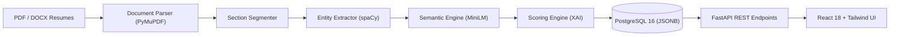

# TalentRank AI — 10-Minute Technical Video Presentation Script
**Project:** TalentRank AI • Technical Evaluation & Precision Resume Matching Engine  
**Purpose:** Technical Recruitment Portfolio Showcase / System Design & Architecture Presentation  
**Target Audience:** Senior Technical Interviewers, Engineering Directors, and Hiring Managers  
**Total Target Duration:** 10:00 Minutes (~1,450 spoken words, ~145 wpm)

---

## Video Production & Presentation Guidelines
- **Visual Split:** 60% Screen Recording (Live UI & Code Architecture), 30% System Architecture Diagrams, 10% Presenter Camera.
- **Audio Tone:** Confident, structured, articulate, engineering-led, and impact-focused.
- **Visual Cues Legend:**
  - `[ON SCREEN]`: What the viewers see on screen (UI, diagrams, IDE).
  - `[ACTION]`: Presenter actions (clicks, code scrolling, hovering).
  - `[SPOKEN]`: The exact narration to deliver.

---

```
========================================================================================
TIMELINE OVERVIEW
========================================================================================
[00:00 - 01:10] Scene 1: The Problem, Hook & System Overview (1:10)
[01:10 - 02:40] Scene 2: High-Level System Architecture & Privacy-First Philosophy (1:30)
[02:40 - 05:00] Scene 3: Deep Dive into the Backend Services & NLP Pipeline (2:20)
[05:00 - 06:45] Scene 4: Database Architecture & Pydantic Schemas (1:45)
[06:45 - 08:15] Scene 5: How Google Stitch & AI Were Used in Design and Development (1:30)
[08:15 - 09:25] Scene 6: Live Product Walkthrough & End-to-End Workflow (1:10)
[09:25 - 10:00] Scene 7: Performance Benchmarks, Impact & Engineering Conclusion (0:35)
========================================================================================
```

---

## [00:00 - 01:10] Scene 1: The Problem, Hook & System Overview
**Visual:** Presenter on camera with a split screen showing traditional ATS failure modes vs. TalentRank AI's sleek dashboard.  
`[ON SCREEN]`: Title Slide: *TalentRank AI: Precision Technical Recruitment Engine*. Transition to live browser showing the Bengaluru Hub dashboard at `http://localhost:5173`.

`[SPOKEN]`:
> "Hello everyone. Today, I am excited to walk you through **TalentRank AI**, a production-ready, privacy-first technical evaluation and resume ranking engine that I designed and engineered from the ground up.
>
> In technical hiring today, traditional Applicant Tracking Systems are fundamentally broken. First, they rely on rigid lexical string matching—meaning an exceptional engineer with 6 years of deep *Flask* or *Django* experience gets automatically rejected if a job description lists *FastAPI*, simply because the keyword isn't identical. Second, legacy ATS tools are notoriously vulnerable to adversarial manipulation, such as candidates hiding white-on-white text or microscopic font keywords to game the parser. Third, they act as unexplainable black boxes that offer recruiters zero defensible rationale for why someone was ranked first or last.

> To solve this, I built TalentRank AI: a 100% on-premise, enterprise-grade platform that combines layout-level document security inspection, semantic section segmentation, hybrid spaCy entity extraction, and multi-vector Sentence-Transformer embeddings—delivering sub-35-millisecond deterministic evaluations, complete explainability, and total data compliance under India's Digital Personal Data Protection Act."

---

## [01:10 - 02:40] Scene 2: High-Level System Architecture & Privacy-First Philosophy
**Visual:** High-resolution architectural flowchart illustrating the 5-stage pipeline from document ingestion to the React frontend.  
`[ON SCREEN]`: Mermaid Architecture Diagram highlighting Container boundaries, FastAPI Backend, PyTorch/SentenceTransformers, spaCy pipeline, PostgreSQL 16 with JSONB, and Vite React frontend.



`[SPOKEN]`:
> "Let’s look at the overarching system architecture. The entire platform runs containerized inside Docker, orchestrated across three services: a **PostgreSQL 16** database with native JSONB support, a high-performance **FastAPI** backend in Python 3.11, and a modern **React 18** client powered by Vite and Tailwind CSS.
>
> A core architectural requirement was zero reliance on third-party cloud APIs like OpenAI or Anthropic. Relying on external LLMs introduces vendor lock-in, recurring token expenses, network latency, and severe privacy violations when sending unredacted candidate PII over the wire.
>
> Instead, TalentRank AI executes 100% of its NLP, vector math, and scoring locally on CPU. We pre-cache lightweight, highly optimized neural models during Docker build time, allowing our complete 5-stage processing pipeline to run securely within corporate firewalls at zero incremental cost per resume."

---

## [02:40 - 05:00] Scene 3: Deep Dive into the Backend Services & NLP Pipeline
**Visual:** Switch to IDE (VS Code) showing `backend/app/services/`. Highlight code blocks as each service is explained.  
`[ACTION]`: Open `document_parser.py`, then `entity_extractor.py`, then `semantic_engine.py`, and finally `scoring_engine.py`.

`[SPOKEN]`:
> "Let's dive under the hood into the backend services that power this pipeline.
>
> **Stage 1: Document Parsing & Adversarial Inspection (`document_parser.py`)**  
> We ingest both PDF and DOCX files. For PDFs, we utilize `PyMuPDF` (`fitz`) to inspect every text span's font size and sRGB integer color. If text font size is below 2.0 points, or if font color is `#FFFFFF` or near-white, the parser strips those characters from the visible text, flags the exact page coordinates, and applies an integrity penalty. For DOCX files, we recursively traverse paragraph runs and nested tables using `python-docx`, checking for the XML `w:vanish` hidden property. This ensures keyword stuffers cannot artificially inflate their scores.
>
> **Stage 2: Section-Aware Segmentation (`section_segmenter.py`)**  
> Rather than treating a resume as an unstructured blob, our segmenter uses regex boundary anchors to divide documents into isolated semantic buckets: `header_contact`, `summary`, `experience`, `projects`, `skills`, and `education`. This ensures that graduation dates in the education section are never mistakenly counted as professional work experience.
>
> **Stage 3: Skill Taxonomy & Temporal Math (`entity_extractor.py`)**  
> Here we combine a curated domain ontology of 303 canonical skills and over 1,600 aliases with a local **spaCy** pipeline (`en_core_web_sm`) using an `EntityRuler`. We handle difficult technical tokens like `C++`, `C#`, `.NET`, and `Node.js` through boundary-aware regex patterns, and prevent false positives on short words like `Go` or `R`.  
> For work tenure, our temporal engine extracts date ranges like *'Aug 2021 to Present'*, converts them into absolute monthly intervals, and mathematically merges overlapping ranges so concurrent internships or freelance projects are never double-counted.
>
> **Stage 4: Multi-Vector Semantic Engine (`semantic_engine.py`)**  
> At the heart of our semantic intelligence is `sentence-transformers/all-MiniLM-L6-v2`. When evaluating skills, we execute a three-tier matching strategy:  
> 1. Exact canonical matching.  
> 2. Semantic adjacent matching: computing dense 384-dimensional cosine matrices between required and candidate skills. If similarity falls between 0.72 and 0.95, soft credit is awarded—for example, bridging *Flask* to *FastAPI* or *MySQL* to *PostgreSQL*.  
> 3. Implicit context chunking: embedding project and experience sentence chunks to identify practical usage of skills even if omitted from the skills list.
>
> **Stage 5: Composite Scoring & Explainable AI (`scoring_engine.py`)**  
> Finally, we compute three normalized sub-scores from 0 to 100: the Skill Score, the Semantic Experience & Role Relevance Score, and the Quantitative Experience Score. These are combined using calibrated recruiter weights. Crucially, we generate deterministic, human-readable analytical explanations quantifying the exact points earned for direct skills, semantic bridges, and tenure differences."

---

## [05:00 - 06:45] Scene 4: Database Architecture & Pydantic Schemas
**Visual:** Display `backend/app/models.py` and `backend/app/schemas.py`. Show SQL diagrams and JSON payloads.  
`[ACTION]`: Highlight the PostgreSQL JSONB columns and Pydantic validation models.

`[SPOKEN]`:
> "Now, let’s explore our data layer and validation contracts.
>
> **The Database Architecture (`models.py`)**  
> We designed a clean relational schema with PostgreSQL that takes full advantage of **`JSONB`** columns. We have two primary tables:
> 1. `job_descriptions`: Stores the job title, raw description text, normalized required skills array, and minimum experience threshold.
> 2. `candidate_evaluations`: Linked via a cascading foreign key to `job_descriptions`. It stores core indexed candidate metadata like name, email, phone, and total experience years, alongside scalar score floats.
>
> By utilizing JSONB for `matched_skills`, `partial_skills`, `missing_skills`, `explanations`, and `segmented_sections`, we achieve the query speed and indexing of a relational database while retaining document-store flexibility. This allows our backend to persist complex XAI bullet points, similarity scores, and adversarial tamper flags without complex join tables or rigid migration bottlenecks.
>
> **Type Safety & Pydantic Schemas (`schemas.py`)**  
> We use Pydantic v2 to enforce strict input validation and response contracts:
> - `JDParseRequest` validates raw text uploads and enforces experience constraints.
> - `CandidateRankingItemSchema` structures the candidate leaderboard payload, packaging overall and individual sub-scores so the frontend can dynamically recalculate rankings on the fly.
> - `CandidateDetailResponse` extends this model for our deep-dive drawer, streaming the full segmented section text and benchmark metadata.
> - `RoleMatcherRequest` and `ReverseRoleMatchItem` power our cross-pool discovery engine, enabling bidirectional matching between candidates and active benchmarks.
>
> Every endpoint is typed, self-documenting via OpenAPI, and fully validated."

---

## [06:45 - 08:15] Scene 5: How Google Stitch & AI Were Used in Design and Development
**Visual:** Side-by-side comparison of Google Stitch HTML/design mockups in `stitch_talentrank_technical_evaluation_engine` next to the React implementation in `frontend/src/`.  
`[ACTION]`: Show the Stitch screen captures, then show the clean JSX React components with Tailwind CSS tokens.

`[SPOKEN]`:
> "One of the most unique aspects of this project is how modern AI tooling and design systems were integrated into the development lifecycle.
>
> **Leveraging Google Stitch for Enterprise UI/UX**  
> Rather than building a generic developer UI, I started with **Google Stitch** design prototypes located in the `stitch_talentrank_technical_evaluation_engine` directory. Stitch provided high-fidelity visual foundations for our five core views: Campaign Setup, the Rankings Leaderboard, the Deep-Dive Drawer, Evaluation History, and the Role Matcher.
>
> I analyzed the Stitch HTML and CSS specifications, extracted key design tokens—such as high-density typography, layered elevation shadows, and status indicators—and re-architected them into modular, maintainable **React 18** components using **Tailwind CSS**.
>
> **Localizing for Indian Technical Recruitment**  
> I then evolved the design specifically for Indian tech hiring:
> - Replaced all generic dollar notations with Indian compensation brackets—for example, *Target CTC: ₹28 - ₹42 LPA*.
> - Configured hub locations across Bengaluru, Hyderabad, Pune, Gurugram, and Mumbai.
> - Built smooth micro-interactions: card-lift hover physics (`.card-hover`), tactile button press scaling (`.btn-press`), and glowing status indicators.
>
> **AI as an Engineering Accelerator**  
> Throughout the build, I leveraged generative AI as an engineering collaborator:
> 1. To synthesize realistic, diverse candidate test corpora across PDF and DOCX formats with varying career lengths and technical stacks.
> 2. To calibrate semantic embedding cosine boundaries and verify soft-credit thresholds against domain heuristics.
> 3. To rigorously refactor codebase services while strictly maintaining schema compliance and deterministic evaluation behavior."

---

## [08:15 - 09:25] Scene 6: Live Product Walkthrough & End-to-End Workflow
**Visual:** Full-screen browser recording of `http://localhost:5173`.  
`[ACTION]`: Live demo: click 'Load 12 Sample Resumes', adjust scoring sliders, click 'Inspect' to open the drawer, view explainability bullets, click 'Shortlist', then switch to 'Talent Matcher'.

`[SPOKEN]`:
> "Let’s see the entire system in action.
>
> Here in **Screen 1 (Job Setup & Ingestion)**, we have our job description for a *Senior Full-Stack AI Engineer in Bengaluru*. Our parser automatically identifies the 4-year tenure requirement and detects 12 core competencies like *FastAPI, PyTorch, React, and pgvector*.
>
> Clicking *'Load 12 Sample Resumes'* simulates batch ingestion. In just 1.2 seconds, all 12 resumes are parsed, checked for hidden text, segmented, vectorized, and scored.
>
> This brings us to **Screen 2 (The Candidate Leaderboard)**. Candidates are ranked objectively. Notice our top candidate, *Omkar Chittar*, leading at 80% with 5.6 years of verified experience. If our engineering team decides tenure is more critical than raw skill match, we can adjust the **Scoring Weightage Calibration** sliders in real time. Notice how the entire leaderboard re-ranks instantly without needing a slow backend round-trip.
>
> Clicking *'Inspect'* slides open **Screen 3: The Deep-Dive Drawer**. Here, there are no black-box scores. Recruiters see exact point attributions: +43.5 points for direct technical matches, +4.2 points for recognized adjacent skills, and clear verification of tenure. We can inspect the candidate's actual projects, education, and toggle the candidate to *'Shortlisted'* with a single click.
>
> Finally, **Screen 4 (Talent Matcher)** allows recruiters to search candidates across past hiring drives or reverse-match an incoming resume against all active company requisitions."

---

## [09:25 - 10:00] Scene 7: Performance Benchmarks, Impact & Engineering Conclusion
**Visual:** Presenter on camera with summary metrics slide displayed.  
`[ON SCREEN]`: Metrics summary:
- *Latency:* < 35ms per candidate evaluation
- *Cost:* $0.00 cloud API fees (100% on-device AI)
- *Privacy:* DPDP Act (India) compliant on-premise execution
- *Integrity:* Automated adversarial keyword-stuffing defense

`[SPOKEN]`:
> "To summarize, TalentRank AI bridges the gap between state-of-the-art NLP and practical enterprise recruitment software. It eliminates keyword cheating, offers true semantic intelligence for adjacent technical skills, and provides hiring teams with 100% explainable, mathematically defensible evaluations.
>
> Architecturally, it demonstrates that you don’t need expensive external LLM APIs to build intelligent applications. With modern sentence transformers, custom spaCy pipelines, and a robust PostgreSQL JSONB data model, we achieved sub-35-millisecond latency, complete data privacy, and a seamless recruiter experience.
>
> Thank you for your time, and I would be thrilled to answer any questions about the system architecture or implementation details."

---

## Production Checklist for Recording
- [ ] Ensure Docker containers are running (`docker compose up -d`) and verified at `http://localhost:5173`.
- [ ] Screen resolution set to 1920x1080 (1080p) at 60 FPS.
- [ ] Microphone input level tested with background noise cancellation enabled.
- [ ] Browser zoom level set to 100% with DevTools closed.
- [ ] VS Code open with `backend/app/services/` and `backend/app/models.py` pre-opened in editor tabs.
